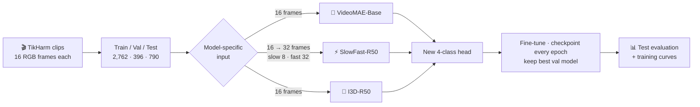

<div align="center">

<a href="#-results"></a>

<br/>


</div>

---

## 📌 Overview

Short-video platforms receive far more uploads than human moderators can review. This project benchmarks **three generations of video-understanding models** on automatically flagging harmful short videos into four classes: **Adult Content, Harmful Content, Safe, and Suicide**.

Each model is fine-tuned from public pretrained weights on the same data, with the same splits and the same evaluation, so the comparison is fair:

| | Model | Family | Core idea |
|:--:|:--|:--|:--|
| 🧩 | **VideoMAE** | Video Transformer | Self-supervised masked-autoencoder pretraining on video patches |
| ⚡ | **SlowFast** | Two-pathway 3D CNN | A slow pathway for appearance and a fast pathway for motion |
| 🧊 | **I3D** | Inflated 3D CNN | 2D ImageNet-style filters inflated into 3D space-time filters |

---

## ✨ Highlights

<table>
<tr>
<td width="50%"><a href="#-dataset"></a></td>
<td width="50%"><a href="#-pipeline"></a></td>
</tr>
<tr>
<td width="50%"><a href="#-results"></a></td>
<td width="50%"><a href="#-training-setup"></a></td>
</tr>
</table>

---

## 🏆 Results

| Model | Pretrained weights | Best val accuracy | **Test accuracy** | Test loss |
|:--|:--|:--:|:--:|:--:|
| 🧊 **I3D** | `i3d_r50` (PyTorchVideo, Kinetics) | **83.08%** | `████████░░` **76.96%** 🥇 | 0.945 |
| ⚡ **SlowFast** | `slowfast_r50` (PyTorchVideo, Kinetics) | 79.04% | `████████░░` **76.96%** 🥇 | 1.042 |
| 🧩 **VideoMAE** | `MCG-NJU/videomae-base` (Hugging Face) | 72.73% | `███████░░░` 71.65% | **0.839** |

> [!IMPORTANT]
> **Key takeaways**
> - **I3D and SlowFast tie on test accuracy (76.96%)**, but I3D gets there with a lower test loss than SlowFast and the highest validation accuracy of all three, making it the most reliable model in this study.
> - **VideoMAE trails by ~5 points in accuracy**, although it has the lowest test loss, meaning its mistakes are made with less over-confidence. Two likely reasons: video transformers usually need more data than ~2.8k training clips to adapt well, and here it received frames scaled to [0, 1] without the mean/std normalisation used during its pretraining.
> - **All three models overfit**: training accuracy climbs to 94–99% while validation stays at 73–83%. Stronger augmentation and regularisation are the clearest path to better generalization.

<div align="center">


<sub>SlowFast training curves: training accuracy approaches 99% while validation plateaus near 79%, a clear overfitting signal</sub>

</div>

---

## 🔄 Pipeline



---

## 📂 Dataset

**TikHarm** short-video dataset (16-frame preprocessed version), downloaded from Kaggle as [`aryansraut/preprocessed-ucf-crime-dataset-visual`](https://www.kaggle.com/datasets/aryansraut/preprocessed-ucf-crime-dataset-visual).

| Class | Train | Val | Test |
|:--|:--:|:--:|:--:|
| 🔞 Adult Content | 684 | 98 | 195 |
| ☠️ Harmful Content | 693 | 99 | 198 |
| ✅ Safe | 698 | 99 | 200 |
| ⚠️ Suicide | 687 | 100 | 197 |
| **Total** | **2,762** | **396** | **790** |

Every sample is a folder of **16 RGB frames at 224 × 224**, and the classes are almost perfectly balanced, so accuracy is a fair headline metric.

> [!NOTE]
> This dataset contains sensitive material and is used strictly for research on automated content moderation.

---

## 🧪 Training Setup

<details open>
<summary><b>Per-model configuration</b></summary>
<br/>

| | 🧩 VideoMAE | ⚡ SlowFast | 🧊 I3D |
|:--|:--|:--|:--|
| Input | 16 × 3 × 224 × 224 | Fast: 32 frames (trilinear interpolation from 16) · Slow: 8 frames (α = 4) | 3 × 16 × 224 × 224 |
| Normalisation | Scaled to [0, 1] | Mean 0.45, std 0.225 | Scaled to [0, 1] |
| Optimizer | AdamW, lr 1e-4 | Adam, lr 1e-4, weight decay 1e-4 | Adam, lr 1e-4 |
| LR schedule | — | ReduceLROnPlateau (×0.5, patience 2) | — |
| Batch size | 4 | 2 | 4 |
| Epochs | Max 15, early stopping (patience 3), stopped at 9 | 8 | 10 |
| Loss | Cross-entropy | Cross-entropy | Cross-entropy |

All runs: Google Colab GPU (the VideoMAE run logged a **Tesla T4**), per-epoch checkpoints for resuming, best model selected on validation accuracy, then evaluated once on the test set.

</details>

---

## 🚀 Getting Started

```bash
git clone https://github.com/RamzanPUCIT/suspicious-activity-detection-video-models.git
cd suspicious-activity-detection-video-models
pip install torch torchvision transformers pytorchvideo av fvcore iopath matplotlib tqdm
```

1. Open any notebook in **Google Colab** with a GPU runtime.
2. Add your Kaggle API key (`kaggle.json`); the notebook downloads and extracts the dataset to `/content/TikHarm_frames_16`.
3. Run the cells in order. Checkpoints, best models, histories and plots are saved to Google Drive.

| Notebook | Model |
|:--|:--|
| `VideoMAE_Model.ipynb` | 🧩 VideoMAE (Hugging Face Transformers) |
| `SlowFast_Assignment.ipynb` | ⚡ SlowFast-R50 (PyTorchVideo) |
| `I3D_Model(Assignment2).ipynb` | 🧊 I3D-R50 (PyTorchVideo) |

---

## 🗂️ Repository Structure

```
suspicious-activity-detection-video-models/
├── VideoMAE_Model.ipynb
├── SlowFast_Assignment.ipynb
├── I3D_Model(Assignment2).ipynb
├── download (1).png                               # SlowFast training curves
├── ChatGPT Image Mar 20, 2026, 06_27_29 PM.png    # Project overview graphic
├── LICENSE                                        # MIT
├── assets/readme/                                 # Animated README graphics (SVG)
└── README.md
```

---

## 🔭 Future Work

- [ ] Per-class precision, recall, F1 and confusion matrices to see which classes get confused
- [ ] Video augmentation (random crops, flips, temporal jitter) and label smoothing to reduce overfitting
- [ ] Ensemble of I3D + SlowFast predictions
- [ ] Add the audio track for multimodal (video + audio) fusion
- [ ] Lightweight model export (ONNX) for near-real-time moderation

---

## 👨‍💻 Author

**Muhammad Ramzan** · M.Phil Artificial Intelligence, PUCIT (University of the Punjab), Lahore

[](https://linkedin.com/in/ramzan-ai)
[](https://github.com/RamzanPUCIT)
[](mailto:founders786@gmail.com)

<div align="center">

⭐ **If this project helped you, consider giving it a star!** ⭐


</div>
